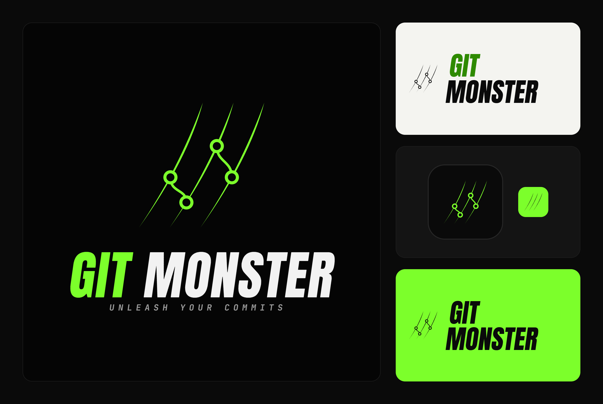

<div align="center">



# GitMonster

**Cliente Git desktop local para Windows, com grafo de commits.**

Escrito em Electron + React + TypeScript.

[](https://www.electronjs.org/)
[](https://react.dev/)
[](https://www.typescriptlang.org/)
[](https://electron-vite.org/)
[](#requisitos)
[](package.json)

</div>

## Baixar

Instaladores em **[gitmonster-releases](https://github.com/carlosbrito/gitmonster-releases/releases/latest)**
(`GitMonster-Setup-<versão>.exe`). O instalador não é assinado: na primeira instalação o Windows mostra
"O Windows protegeu o computador" → **Mais informações** → **Executar assim mesmo**. Depois disso, o próprio
app avisa quando houver versão nova.

## Requisitos

- Windows, Node.js 22.19+ / 24.11+ e npm
- **Git** no `PATH` (o app chama o `git` do sistema; credenciais ficam com o Git Credential Manager)

## Como rodar

```powershell
npm install        # o postinstall baixa o binário do Electron (install-electron)
npm run dev        # desenvolvimento, com recarga
npm run build      # gera out/
npm run preview    # roda o build
npm test           # testes unitários e de integração (Git real em pastas temporárias)
npm run typecheck
npm run brand        # regenera ícone e logotipo a partir de branding/git-monster-logo@2x.png (PowerShell)
npm run dist         # gera o instalador do Windows em release/ (NSIS, x64)
npm run dist:dir     # só a pasta do app, sem instalador (release/win-unpacked)
npm run test:packaged # smoke test do app empacotado
npm run test:e2e   # testes ponta a ponta no app real (Electron + playwright-core)
```

### Publicar uma versão

```powershell
npm version minor          # ou patch: sobe a versão no package.json e cria a tag vX.Y.Z
git push --follow-tags     # o workflow "release" testa, empacota e cria um RASCUNHO em gitmonster-releases
npm run stats              # downloads do instalador por versão (contadores do GitHub Releases)
```

No Claude Code, `/publicar [patch|minor|major]` faz o fluxo inteiro (confere pré-condições, escreve as notas,
acompanha o workflow, revisa o rascunho e publica depois de confirmar). A skill fica em `.claude/skills/publicar/`.

Revise o rascunho em [gitmonster-releases/releases](https://github.com/carlosbrito/gitmonster-releases/releases) e
clique em **Publish release**: só então os apps instalados recebem o aviso. O workflow precisa do segredo
`RELEASES_TOKEN` (token fine-grained com `Contents: write` apenas em `gitmonster-releases`).

> Electron 44 não baixa mais o binário sozinho: se aparecer `Electron uninstall`, rode `npm exec -- install-electron`.

## O que faz

| Área | Recursos |
| --- | --- |
| Configurações | Tema (sistema/claro/escuro), **perfil do Git** (global ou só do repositório), **editor externo** ("Abrir no editor" nos arquivos) e versão instalada com "Verificar agora" |
| GitHub | Conexão por **token pessoal** (guardado criptografado pelo sistema); **Pull Requests**: listar (abertos/fechados), detalhe, criar a partir da branch atual, checkout do PR e abrir no navegador |
| IA | Com a **sua própria chave** (Anthropic, OpenAI, Google Gemini ou qualquer servidor compatível com OpenAI, como Ollama): **mensagem de commit** a partir do stage, **explicar alterações** (locais ou de um commit), **mensagem de stash**, **título e descrição de Pull Request** (usa o template do repositório) e **resolução de conflitos** por bloco, com explicação e confiança, que você revisa antes de salvar. Instruções globais e por recurso (com atalhos) e modelo por recurso, nas Configurações |
| Instalação | Instalador NSIS para Windows. O app **verifica sozinho** (ao abrir e a cada 6 h) e **só avisa**: faixa com "Ver novidades", "Atualizar" e "Depois"; baixa quando você pede e instala ao reiniciar ou fechar |
| Abas e sessão | Vários repositórios em abas (cada uma guarda sua seleção e diff); ao reabrir o app, as mesmas abas e a lista de recentes voltam |
| Tela inicial | Abrir repositório, **clonar por URL**, **criar** (`git init`) e reabrir recentes |
| Busca | Campo de busca (Ctrl+F) por mensagem, autor, hash, arquivo ou conteúdo (pickaxe); a consulta é sempre tratada como texto |
| Diff | Unificado ou **lado a lado**, com **destaque de sintaxe** (JS/TS, C#, Python, Go, Rust, JSON, YAML, SQL e outras) |
| Arquivo | **Histórico do arquivo** (segue renomeações) e **blame** (na árvore de trabalho ou em qualquer commit), pelo menu de contexto |
| Grafo | Três colunas: **BRANCH / TAG** (etiquetas de cada commit, ligadas ao nó; ícone de computador = local, nuvem = remota), **GRAPH** (pistas coloridas, merges, anel no HEAD) e **COMMIT MESSAGE** (barra colorida, assunto, autor, data relativa e avatar). Linha **// WIP** com as alterações não commitadas, coluna de etiquetas redimensionável, rolagem virtualizada (canvas) e paginação automática |
| Monitor | Painel **Monitor** com os comandos `git` que o app executa, prontos para colar no terminal ("Copiar cd", "Copiar tudo"); leituras (status, log...) ficam escondidas por padrão; credenciais em URLs são ocultadas |
| Working tree | Stage/unstage por arquivo **e por hunk**, **descartar alterações** (arquivo, hunk ou todos; com confirmação, sem desfazer), diff com números de linha, commit e amend |
| Branches | Criar, checkout (local, remota, commit), **renomear**, apagar (com dupla confirmação), merge, rebase. **Arraste uma branch sobre outra** (na sidebar ou pelas etiquetas do grafo, soltando na etiqueta ou na linha do commit; duplo clique na etiqueta faz checkout) e escolha entre **merge** (de A em B) e **rebase** (de A em cima de B); o app muda de branch quando o Git exige |
| Remotos | Fetch (`--prune`), **pull com modo** (somente fast-forward, merge ou rebase), push (grava upstream), force push (`--force-with-lease`) |
| Histórico | Detalhe do commit com arquivos e diff, cherry-pick, revert, reset (soft/mixed/hard), branch/tag no commit |
| Remotas | Branches remotas **agrupadas por remote** (recolhíveis); adicionar e remover remotes; apagar uma branch no servidor (com confirmação) |
| Tags | Criar (leve ou anotada), publicar, apagar |
| Rebase | Simples e **interativo** (reordenar, `squash`, `fixup`, `drop`) |
| Conflitos | **Editor de conflitos**: por bloco escolhe nosso, deles, ambos ou edita à mão, com o resultado à vista; arquivo inteiro de um lado (inclusive modify/delete); depois é só continuar a operação |
| Desfazer | **Desfazer/Refazer** a última operação (commit, amend, merge, pull, cherry-pick, revert, reset, checkout) pelo reflog |
| Menu de contexto | Botão direito em commit, branch, tag e arquivo, com as mesmas ações dos botões |
| Operações paradas | Merge, cherry-pick, revert e rebase em andamento: continuar, pular ou abortar |
| Stash | Guardar (com/sem arquivos novos), aplicar e remover, descartar |

## Arquitetura

```
src/main/      processo principal: GitService, WorkTree, Branches, Operations, Discard, Clone, Session, IPC (validado com zod)
src/preload/   ponte mínima e tipada (contextBridge) — não expõe ipcRenderer
src/renderer/  React: App (abas/sessão), RepoView (um repositório), hooks/ (estado), actions/ (ações), grafo em canvas, painéis, diálogos
src/shared/    tipos do contrato IPC e o algoritmo de pistas do grafo (função pura)
tests/         vitest — parsers puros + integração com repositórios Git reais
e2e/           roteiros ponta a ponta com o app real
```

- **Git via CLI** (`execFile`, sem shell): saída previsível (`--porcelain=v2 -z`) e fidelidade ao terminal.
- **Algoritmo de grafo** (`src/shared/graph/layoutGraph.ts`): atribui pistas em ordem topológica, é resumível
  entre páginas e processa 50 mil commits em ~40 ms.

## Decisões de segurança

- O renderer **nunca escolhe o diretório de trabalho**: o main só aceita repositórios que o usuário abriu pelo diálogo nativo.
- Todo argumento IPC é validado (zod). Caminhos rejeitam `..`, caminho absoluto e NUL; nomes de ref e hashes são
  validados e passados após `--end-of-options`, então um nome começando com `-` nunca vira opção do Git.
- O renderer **não envia patches**: para stage por hunk ele manda `{arquivo, índice, cabeçalho}` e o main recalcula o
  diff, recusando se o arquivo mudou. No rebase interativo o roteiro é gerado no main e só aceita permutação exata do intervalo
  (não dá para injetar linhas como `exec`).
- Janela com `contextIsolation`, `sandbox`, sem `nodeIntegration`, CSP restritiva e navegação externa bloqueada.
- O token do GitHub é guardado só criptografado (`safeStorage`/DPAPI) e nunca chega ao renderer; sem criptografia no sistema, o app recusa guardá-lo. As requisições vão só para `api.github.com`, sem seguir redirecionamentos, e a URL de "abrir no navegador" é montada no main.
- A **IA** é desligada por padrão e usa só a chave do usuário. A chave de cada provedor é guardada só criptografada (`safeStorage`/DPAPI), fica no main e nunca chega ao renderer (a tela só sabe se existe uma). O renderer pede cada recurso com identificadores (repositório, hash, caminho); quem lê o diff e monta o prompt é o main. As chamadas vão só ao endpoint configurado (`https://`, ou `http://` em `localhost` para modelos locais), sem seguir redirecionamentos, sem telemetria. Antes do primeiro envio de código a cada provedor o app pede consentimento. Conteúdo do repositório dentro do prompt é tratado como dado (um `</diff>` no código não fecha o bloco), diffs grandes são cortados dentro do limite (lockfiles, arquivos gerados e binários saem primeiro) e a resposta da IA nunca é aplicada sozinha: commit, stash, PR e conflito só mudam quando você confirma.
- O editor externo roda sem shell (nome de arquivo com `&` ou aspas não vira comando); `.cmd`/`.bat` são recusados e o `code` do VS Code é resolvido para o `Code.exe`.
- A atualização só aceita URL `https://`, só roda no app instalado e nunca baixa sozinha.
- A sessão (`session.json` em `userData`) só guarda repositórios que o usuário abriu; ao ler, cada raiz é revalidada
  e o main só registra as que continuam sendo repositórios Git.
- Clone aceita só `https://`, `ssh://`, `git@host:caminho` e `file://`, recusa URL começando com `-` e roda com
  `protocol.ext.allow=never`; nunca sobrescreve uma pasta existente.
- Ações destrutivas (apagar branch, reset, force push, abortar operação, descartar stash, descartar alterações) pedem confirmação na interface.
- Operações de rede têm timeout de 120 s e não esperam prompt de terminal.

## Limites conhecidos

- O editor de conflitos trabalha com os marcadores do Git: arquivo binário, grande ou fora de UTF-8 só aceita "arquivo inteiro: nosso/deles".
- Desfazer/Refazer age sobre **uma** operação por vez; rebase, stash e outras operações não são desfeitas, e o desfazer destrutivo exige árvore limpa.
- Stage por hunk, não por linha.
- O destaque de sintaxe é por trecho do diff (blocos longos de mais de 2000 linhas ficam sem cores) e cobre um conjunto fixo de linguagens.
- O blame não segue linhas movidas entre arquivos (`-C`) nem ignora commits de reformatação. Descartar alterações não tem desfazer nem backup.
- O clone mostra só "trabalhando…" (sem barra de progresso).
- O merge por arrastar: na sidebar usa o arrastar-e-soltar nativo do navegador; no grafo, o ponteiro (sem HTML5 DnD). Os dois foram exercitados nos testes com mouse real (via protocolo do Chromium), não por um humano.
- Ao abrir, o app mostra uma **splash de 5 s** com o logo. Para pular (testes, automação), defina `GITMONSTER_NO_SPLASH=1`.
- Os dados do app (sessão, configurações, token do GitHub) ficam em `%APPDATA%\GitMonster`.
- Colunas além do teto da pista do grafo (360 px) são recortadas.
- Sem integração com GitHub/GitLab/Bitbucket, submódulos, LFS ou rebase com `--rebase-merges`.
- Autenticação do Git depende do Git Credential Manager do sistema; só foi testado contra remotes locais.
- GitHub só por token pessoal (sem login OAuth, que exigiria um app registrado) e só GitHub: sem GitLab, Bitbucket ou Azure DevOps. A API foi testada contra um servidor simulado, não contra o GitHub de verdade.
- IA: testada contra servidores simulados (unitários e e2e), não contra os provedores reais. Os ids de modelo recomendados são sugestões fixas e podem mudar; a lista completa vem sempre do provedor. Sem Azure OpenAI e sem streaming. A resolução de conflito é uma proposta: confira antes de salvar.
- O instalador **não é assinado** (exige certificado de assinatura de código): o Windows mostrará o aviso do SmartScreen na primeira instalação. As atualizações vêm das releases públicas em `gitmonster-releases` (HTTPS do GitHub); sem assinatura, a confiança nelas é a dessa conta do GitHub. `GITMONSTER_UPDATE_URL` troca o feed (testes/homologação).
- Só Windows x64 (o alvo do instalador); macOS e Linux não foram empacotados.
